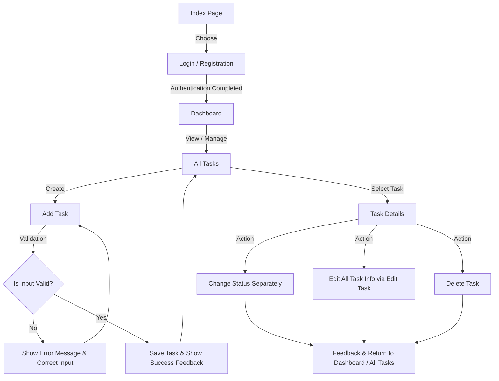

# Product Requirements Document (PRD)
## Priori — Smart Priority Task
*English Version | Module 7*

---

## Document Information

| Field | Details |
| :--- | :--- |
| **Product Name** | Priori — Smart Priority Task |
| **Product Type** | Student task management website |
| **Team** | Group 19 |
| **Division** | Web & UI/UX Developer |
| **Members** | Firda Nabilah, Deni Anugrah Hasibuan, Dewangga Arka Putra, Luthfi Eka Saputra, Komsiata Amelia Sari |
| **Stage** | Module 7 interactive web prototype development |
| **Requirements Source** | User research and persona, User Flow/Wireframe, Figma prototype, and HTML5 implementation from previous modules |
| **Prototype Link** | [Figma Prototype (Kelompok 19)](https://www.figma.com/design/JFSkyYMAdzRiTfJcK7KjiL/Prototipe-Kelompok-19?node-id=0-1&t=a5sTTIdJfLxgTS2p-1) |

---

## 1. Role (Role Persona)

### AI Role
Act as a Technical Lead Project Manager (PM) who prepares a PRD for the Priori website. The document must be user-oriented, consistent with the research findings and designs from previous modules, and usable by the UI/UX and development teams as a reference for implementation and testing.

### Product
**Priori — Smart Priority Task**, a website that helps students manage academic assignments and determine which tasks should be prioritized.

### Target Users
Active university students, especially those in semesters 3–7, who have multiple assignments from different courses with closely spaced deadlines.

### Representative Persona

- **Age**: Approximately 19–20 years old
- **Status**: Active university student
- **Semester**: 3–7

#### Characteristics
- Active, independent, practical, and focused on completing tasks.
- Accustomed to recording assignments through WhatsApp, Notes, Google Keep, or a calendar.
- May feel overwhelmed when assignments pile up and deadlines are close together.
- Needs centralized task information that is easy to understand.

#### Persona Goals
- Identify which tasks need to be completed first.
- Complete assignments before or by their deadlines.
- Manage time between classes, assignments, and other activities.
- Reduce the risk of forgetting assignments or deadlines.

#### Persona's Main Problems
- Assignment information is scattered across several platforms.
- Reminders can get buried or go unnoticed.
- It is difficult to estimate task completion time and determine priorities.
- A large number of assignments can cause stress, confusion, procrastination, and disruption to other activities.

---

## 2. Context (Design Context)

### 2.1 Background
Priori was developed in response to the problem of accumulating deadlines and students' difficulty in determining task priorities. Previous user research shows that students have different habits: some complete the easiest assignments first, some prioritize the nearest deadlines, and others consider the difficulty level and estimated completion time.

Students also use different platforms to record assignments, such as WhatsApp, Notes, Google Keep, and calendars. Scattered information increases the risk of forgetting assignments, while buried or missing notifications can make deadline tracking difficult. When assignments pile up, students may feel stressed, confused, uneasy, or be forced to complete tasks in a rush.

Therefore, Priori is designed as a centralized system for recording assignments, monitoring completion status, viewing deadlines, and helping users identify which tasks should be prioritized.

### 2.2 Product Objectives
- Provide one place to record and manage coursework.
- Display deadlines, difficulty levels, estimated time, descriptions, and task statuses in a structured way.
- Help users determine task order based on task information.
- Make it easier for users to add, view, edit, and delete tasks.
- Present progress summaries through the Dashboard.
- Provide a clear, consistent, and testable interface flow.

### 2.3 Usage Context
Users access Priori when receiving new assignments, planning their work, checking deadlines, updating task statuses, or reviewing unfinished assignments. The website is intended for use on smartphones as well as laptops/desktops, while prioritizing information readability and ease of navigation.

### 2.4 Page Structure and Functions

1. **Index**: Introduces Priori and provides access to Login and Registration.
2. **Login**: Provides an email and password form with validation.
3. **Registration**: Provides an account creation form with validation.
4. **Dashboard**: Displays a summary of the number of tasks (total, completed, in progress, and not started) as well as a list of tasks that need attention.
5. **All Tasks**: Displays the task list, search, filters, and access to Task Details, Add Task, and Edit Task.
6. **Task Details**: Displays the title, course, deadline, difficulty level, priority, description, and status. Users can change the status or delete the task.
7. **Add Task**: Provides a form for the course, task title, deadline, difficulty level, status, estimated time if implemented, and description/notes.
8. **Edit Task**: Displays existing data so users can update all task information.
9. **Notifications**: Displays deadline reminder information according to the implementation capabilities.
10. **Success/Confirmation**: Provides feedback after an action is completed successfully.
11. **Empty/Error**: Explains an empty-data or failure condition and provides relevant next actions.
12. **Profile**: Displays the user's profile information.
13. **Settings**: Displays the basic settings planned for the prototype.

### 2.5 Main Flow

- The user opens the Index page, then chooses Login or Registration.
- After completing the authentication flow, the user enters the Dashboard.
- The user opens All Tasks to view and manage the task list.
- The user can add a task through Add Task.
- The system validates the input. If the input is invalid, an error message is displayed so the user can correct it.
- If the input is valid, the task is saved according to the implementation capabilities, and the user receives success feedback.
- The user can open Task Details, change the status separately, edit all task information through Edit Task, or delete the task.
- After an action, the system provides appropriate feedback and a path back to the Dashboard or All Tasks.

### 2.6 Design Principles
- Follow the structure and flow of the Figma prototype created in the previous module.
- Use simple and consistent interface language.
- Emphasize deadlines, statuses, and important task information.
- Provide clear validation and error messages.
- Ensure that no primary buttons or links are non-functional.
- Provide a responsive layout that remains easy to use on small screens.
- Use content relevant to student task management.

---

## 3. User Story & Scope Limitations

### 3.1 User Stories (US)

| ID | User Story |
| :--- | :--- |
| **US-01** | As a student, I want to log in to Priori so that I can access the task management page. |
| **US-02** | As a new student, I want to register so that I can start using Priori. |
| **US-03** | As a student, I want to see a task summary on the Dashboard so that I can quickly understand my task progress. |
| **US-04** | As a student, I want to view all tasks so that I can monitor the assignments that need to be completed. |
| **US-05** | As a student, I want to add tasks along with the course, title, deadline, difficulty level, status, and description so that the task information is recorded. |
| **US-06** | As a student, I want to view task details so that I can understand the information about a selected task. |
| **US-07** | As a student, I want to change all task information through Edit Task so that the data remains up to date. |
| **US-08** | As a student, I want to update a task's status separately from editing its information so that completion progress can be monitored easily. |
| **US-09** | As a student, I want to delete tasks that are no longer needed so that the task list remains relevant. |
| **US-10** | As a student, I want to search or filter tasks so that I can find specific tasks more easily. |
| **US-11** | As a student, I want to view deadline reminder information so that I can pay attention to tasks approaching their deadlines. |

### 3.2 MVP Scope (In-Scope)

#### Main Features Included:
- Index, Login, and Registration pages as part of the prototype flow.
- Dashboard and task summaries by status.
- All Tasks list.
- Add Task with input validation.
- Task Details.
- Editing all task information.
- Changing task status separately.
- Deleting tasks with appropriate feedback.
- Task search and filtering if supported by the implementation.
- Empty, error, validation, and success states.
- Navigation to Notifications, Profile, and Settings according to the available pages.
- At least two dynamic interactions that can be demonstrated and tested.
- Interface consistency with the Figma design and readability across different screen sizes.

#### Planned Task Data:
- Course
- Task title
- Deadline
- Difficulty level
- Task status
- Description/notes
- Estimated completion time and priority information, if implemented

#### Task Statuses:
- `Not Started`
- `In Progress`
- `Completed`

### 3.3 Out of Scope

The following features are not considered mandatory requirements unless explicitly agreed upon by the team:
- Production authentication connected to a real backend service.
- Database and cross-device data synchronization if the Module 7 implementation does not include a backend.
- Automated scheduled notifications on the device.
- Integration with Google Calendar, email, WhatsApp, or third-party services.
- Automatic difficulty assessment using AI.
- Task collaboration and task distribution among users.
- Advanced analytics or recommendations based on machine learning models.
- Payment features or subscription services.

> [!NOTE]
> Module 6 produced static semantic HTML5 pages that do not yet implement authentication or database-based data processing. Therefore, functionality that actually works in Module 7 must be distinguished from interfaces that are still simulations/prototypes. H-3/H-1 deadline reminders are a need identified through user research, but automated notifications are mandatory criteria only if they are included in the implementation agreed upon by the team.

---

## 4. Deliverables / Success Criteria

### 4.1 Product Deliverables
- A demonstrable Priori website prototype.
- Pages according to the agreed scope, with interconnected navigation flows.
- Task forms with relevant data fields and validation.
- Interactions for viewing details, adding, editing, changing status, and deleting tasks according to the implementation capabilities.
- Feedback for successful actions, invalid input, and empty-data or error conditions.
- An interface consistent with the Figma design and persona needs.
- Development documentation in accordance with the Module 7 assignment requirements.

### 4.2 Acceptance Criteria

| ID | Acceptance Criteria |
| :--- | :--- |
| **AC-01** | Users can open the Index page and find access to Login and Registration. |
| **AC-02** | The main navigation directs users to the correct pages. |
| **AC-03** | The Dashboard displays summaries of total tasks, completed tasks, tasks in progress, and tasks not started, based on the available data. |
| **AC-04** | The Add Task form contains the task information specified in the scope. |
| **AC-05** | The system displays a validation message when required input is missing or invalid. |
| **AC-06** | After a successful save, users receive success feedback and can return to the task list or Dashboard. |
| **AC-07** | Users can open Task Details and view the information for the selected task. |
| **AC-08** | Users can edit all task information through the Edit Task page. |
| **AC-09** | Users can change a task's status without having to edit all task information. |
| **AC-10** | Users can perform a delete action and receive appropriate feedback. |
| **AC-11** | Available search or filters help users find tasks by keyword or supported category. |
| **AC-12** | Empty/error pages display understandable information and provide relevant next actions. |
| **AC-13** | At least two dynamic interactions work and can be demonstrated. |
| **AC-14** | No primary button or link leads to a dead end. |
| **AC-15** | The content and interface are consistent with the Priori context and readable at supported screen sizes. |

### 4.3 Success Indicators
- The features defined as MVP are available and testable.
- The main task management flow can be completed without navigation obstacles.
- Users can understand task deadlines and statuses from the information displayed.
- Validation and feedback messages help users understand errors and the results of their actions.
- The main interactions can be demonstrated by the team.
- The implementation does not claim backend, database, or automated notification features that have not actually been built.
- The website is consistent with the user research, user persona, User Journey, User Flow, wireframe, and Figma prototype from previous modules.

---

## Closing

This PRD serves as a reference for Group 19 in developing Priori for Module 7. Feature decisions and testing criteria must continue to refer to the user problems identified in previous research: accumulating deadlines, scattered task information, difficulty determining priorities, and the need for structured task recording and status tracking. Features that are outside the scope or have not actually been implemented must not be described as functioning features.
